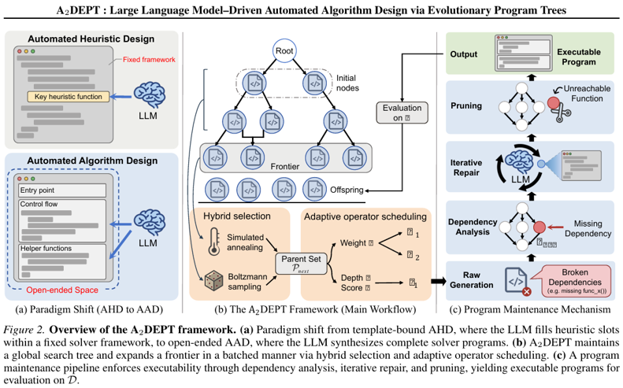

## Why it matters

An effective heuristic can still be limited by the solver framework around it. A2DEPT allows the LLM to change a program's strategy and control flow, while using explicit maintenance mechanisms to manage the resulting risk of broken interfaces and missing functions.

## Core method

The framework maintains a search-history tree. Each node contains a complete executable program, its score, generation history and operator weights. The tree records relationships between program versions. It is not a syntax tree or a hierarchy whose nodes are individual solver modules.

Within each program, a separate function registry distinguishes immutable utilities from mutable strategy functions. Micro-tuning edits strategy code while preserving interfaces. Macro-mutation reconstructs the entry-point workflow and can introduce new function dependencies. Semantic crossover combines mechanisms from two complete parent programs. Mutation preferences adapt to observed parent-child performance changes, while crossover partners balance quality and divergence of their search histories.

After an edit, a dependency graph identifies undefined functions. The LLM implements missing dependencies, and reachability analysis removes unused code. Incomplete candidates are penalized if the repair budget expires. Evaluated programs enter the lineage tree. Simulated-annealing acceptance selects the next frontier, supplemented by Boltzmann sampling from historical nodes. Reheating encourages exploration after stagnation.

## Contributions

- Whole-solver evolution with distinct mechanisms for trajectory memory, function-level edits and dependency repair.
- Adaptive choice between local refinement and workflow restructuring, together with non-greedy reuse of earlier programs.
- Main experiments on six combinatorial optimization tasks, with supplementary studies of numerical integration, root-finding and feedback control.

## Strengths and limitations

The paper compares constructive, guided-local-search and whole-program design settings, and includes both fixed-call and supplementary token-cost comparisons. The results do not establish that unrestricted synthesis always beats strong task-specific structure. Guided local search with expert scheduling operators is stronger on some FJSP comparisons. Dependency closure also does not guarantee semantic correctness. The paper documents a refactoring that changes a set into an integer bitmask and breaks another module's type expectations. Continuous-domain experiments are supplementary and show mixed performance, including weakness on nonlinear ODEs.

## What to improve

Add cross-function type contracts, report repair failures and costs separately, and test whether the method scales from research prototypes to larger multi-file solvers without losing reliable evaluation.

## Connections

Like MCTS-AHD, A2DEPT retains program-generation trajectories, but its nodes hold whole solvers and its parent selection uses annealing and Boltzmann sampling rather than MCTS selection and backpropagation. ATLAS explicitly describes A2DEPT as concurrent work on full-algorithm synthesis. DGA2D exposes operator execution order as a design graph, whereas A2DEPT's tree records program ancestry and its separate dependency graph supports repairs.
